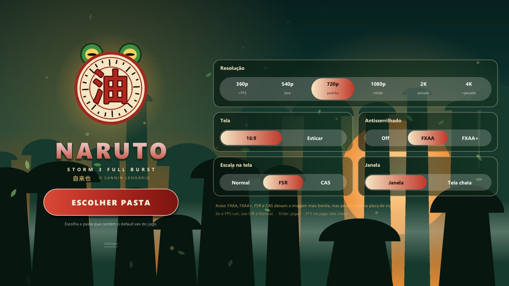
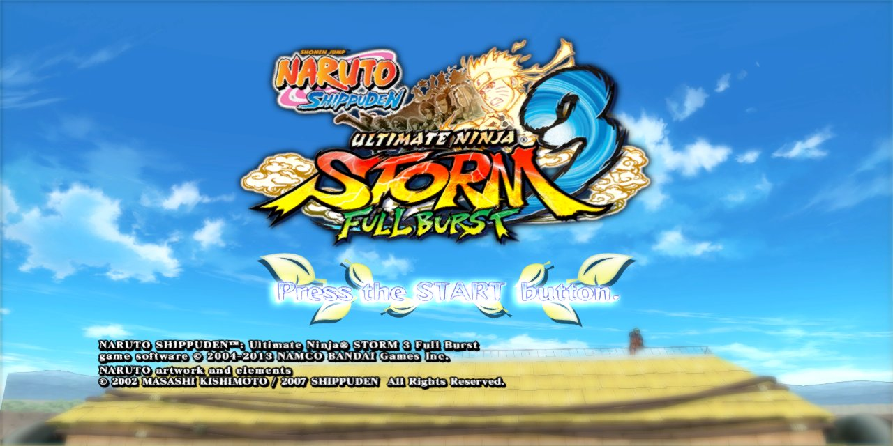
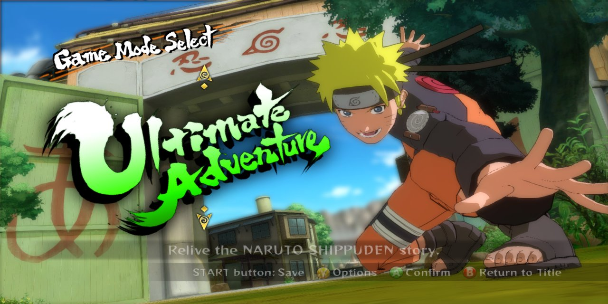
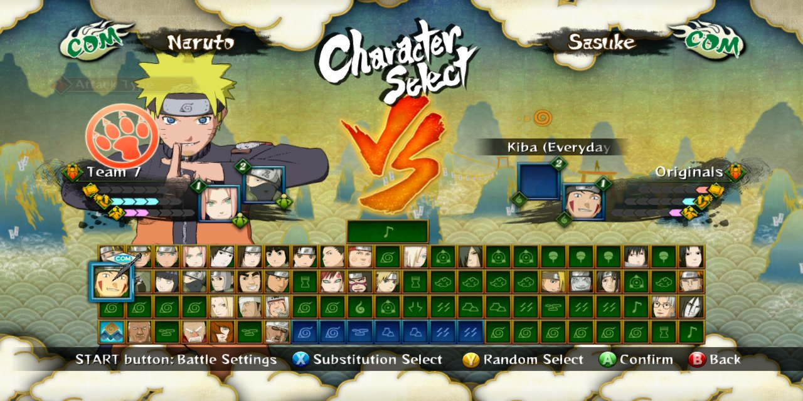
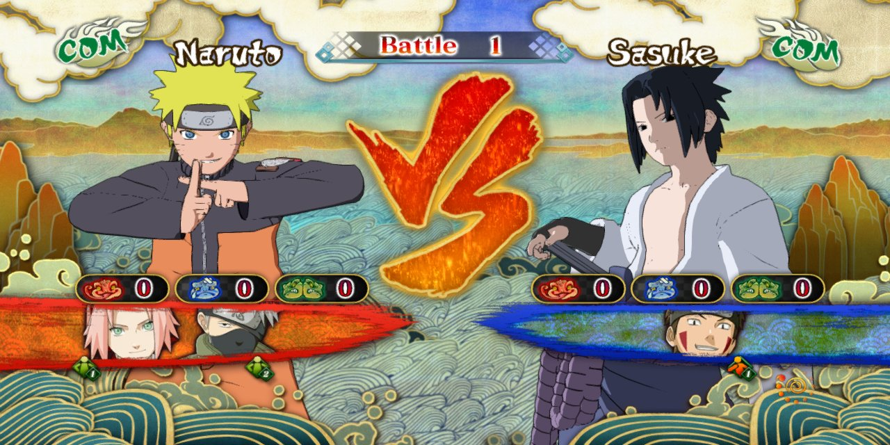
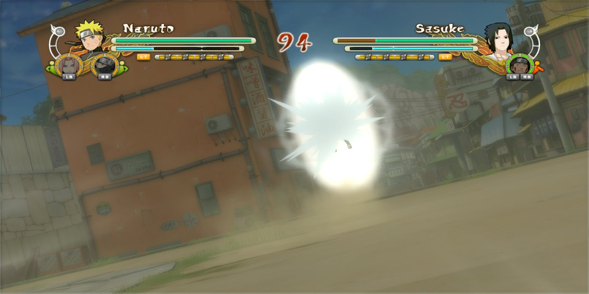

<div align="center">


# 🐸 Naruto Shippuden: Ultimate Ninja Storm 3 Full Burst — Port Nativo

**O jogo de Xbox 360 rodando nativamente no Android (ARM64) e no PC (Windows x64), sem emulador de CPU.**


[**⬇️ Baixar (Android e PC)**](../../releases) · [Requisitos](#-requisitos) · [Instalação](#-instalação) · [Configurações](#%EF%B8%8F-configurações) · [Perguntas](#-perguntas-frequentes)



</div>

---

## 📖 Sobre

Este port **não é um emulador de Xbox 360**. O executável do jogo (`default.xex`) foi **recompilado estaticamente** de PowerPC para ARM64 (celular) e x86-64 (PC): o resultado é código nativo, que roda direto no processador. Desde a v0.4.1 a parte gráfica usa o **shadowZero**, um renderizador nativo que pega os comandos Direct3D do jogo e desenha direto em Vulkan, sem emular a GPU do Xbox 360. Isso deixa o jogo bem mais leve e permite escolher a resolução interna de **360p até 4K**. Em celulares cuja GPU não tem o que o shadowZero precisa, o app usa sozinho o backend Vulkan do Xenia, como nas versões anteriores.

> [!IMPORTANT]
> **O APK e o pacote de PC não contêm nenhum arquivo do jogo.** Você precisa da sua **própria cópia** de *Naruto Shippuden: Ultimate Ninja Storm 3 Full Burst* para Xbox 360, na versão indicada em [Versão do jogo](#-versão-do-jogo-obrigatória).

### ✨ Destaques

- **Lutas a 30 FPS** (o limite do próprio jogo), com o conteúdo do **Full Burst** carregado.
- **Renderizador nativo shadowZero** (Direct3D → Vulkan), com resolução interna de **360p, 480p, 720p, 900p, 1080p, 2K e 4K** (padrão 480p). Roda em Mali, Adreno (inclusive Adreno 610) e com drivers Turnip.
- **FPS escolhido no menu:** 20, 24 ou 30 (o limite do jogo), com a lógica do jogo no tempo certo (sem câmera lenta).
- **⚡ Modo desempenho:** tira as sombras **em qualquer resolução** (não trava mais em 480p).
- **Brilho e cores iguais aos do Xbox 360:** o bloom e a exposição da luta não estouram mais.
- **GPU bem mais leve em resolução alta:** num POCO F3 (Adreno 650) a luta a 1080p foi de 18 para 30 FPS, e a nova **900p** roda a 30 FPS com folga.
- **Antisserrilhado FXAA e FXAA+** e **escala FSR 1.0 / CAS** da AMD, que podem ser ligados e desligados.
- **Controles na tela no estilo dos jogos de Naruto para celular:** losango Y/X/B/A igual ao do controle, selos coloridos com a letra de cada botão, LT/RT/LB/RB, START e SELECT escritos, o botão **DESPERTAR** (analógico direito para o lado) e os atalhos de **jutsu**, **jutsu secreto** e **avanço**.
- **Dois controles:** o primeiro controle que conecta é o **jogador 1** e o segundo é o **jogador 2**, sozinhos. Em **MAPEAR** dá para trocar os botões de cada um (**Controle 1** e **Controle 2**), se quiser; sem mapear, os dois usam o padrão.
- **Controle físico automático:** plugou um controle, os botões da tela somem; tirou, eles voltam. Pelo emblema do Shadow no canto da tela dá para **editar os botões** ou usar **toque + controle** juntos.
- **Menu com a abertura do próprio jogo** tocando (sem som) na coluna da esquerda, letras maiores e **Save 100% ligado de fábrica**.
- **Atualização automática:** ao abrir o menu, o app avisa quando sai versão nova aqui no GitHub e já baixa e instala.
- **Drivers de GPU customizados (Turnip)** em celulares **Snapdragon**, importados direto pelo menu.
- **Áudio sem picotes** nas quedas, jutsus e suportes.
- **Painel de desempenho:** FPS, resolução e uso de CPU, GPU e RAM. Pode ser arrastado pela tela ou recolhido.
- **Modo 16:9 ou esticado** para a tela inteira.
- Menu inicial animado com tema do **Jiraiya** 🐸, o mesmo no celular e no PC: o Monte Myoboku ao entardecer, folhas e chakra dourado em volta do selo do 油, com os olhos do sapo espiando.
- **Versão de PC** com janela ou tela cheia, teclado e controles de Xbox ou PlayStation.

## 📸 Capturas

| Tela de título | Modos de jogo |
|:---:|:---:|
|  |  |
| **Seleção de personagens** | **Antes da luta** |
|  |  |
| **Luta** | |
|  | |

## 📱 Requisitos

### Android

| | Mínimo | Recomendado |
|---|---|---|
| **Android** | 11 (API 30) | 13 ou mais novo |
| **Processador** | ARM64 (arm64-v8a) | Snapdragon 8 Gen 1 / Dimensity 8000 ou superior |
| **GPU** | Vulkan 1.1 | Mali-G710 / Adreno 730 ou superior |
| **RAM** | 4 GB | 8 GB ou mais |
| **Espaço** | ~7 GB (arquivos do jogo) | — |

### 🖥️ PC

| | Mínimo | Recomendado |
|---|---|---|
| **Sistema** | Windows 10 64 bits | Windows 11 |
| **Processador** | x86-64 com AVX | 4 núcleos ou mais |
| **Placa de vídeo** | Vulkan 1.1 (drivers atualizados) | GTX 1060 / RX 580 ou superior (2K e 4K: RTX 3060 / RX 6700 ou superior) |
| **RAM** | 4 GB | 8 GB ou mais |

## 💿 Versão do jogo (obrigatória)

O port foi feito para **uma versão específica** do executável, a do **disco norte-americano** 🇺🇸🇨🇦. O código foi recompilado a partir deste arquivo, então o que vale é o `default.xex` ser **idêntico**: confira o hash abaixo.

| Campo | Valor |
|---|---|
| Jogo | Naruto Shippuden: Ultimate Ninja Storm 3 Full Burst (Xbox 360) |
| **Região do disco** | **América do Norte, NTSC-U** |
| Title ID | `4E4D085C` |
| Media ID | `2576927D` |
| Versão do executável | `0.0.0.9` |
| Trava de região do executável | somente NTSC-U (América do Norte) |

| Arquivo | Tamanho | SHA-1 | MD5 |
|---|---|---|---|
| `default.xex` | 11.218.944 bytes | `f7ad65e26a00df6c29c9d34b291819593e455e9f` | `fd8ac164bcc8e380e84644402b6a0666` |

<details>
<summary><b>Como conferir o hash</b></summary>

- **Windows (PowerShell):** `Get-FileHash default.xex -Algorithm SHA1`
- **Linux / macOS:** `sha1sum default.xex`
- **Android:** qualquer app de "hash checker" da Play Store.

</details>

### Estrutura da pasta do jogo

Extraia o disco e copie **a pasta inteira** para o celular. Ela precisa ter:

```
Naruto Shippuden Ultimate Ninja Storm 3 Full Burst/
├── default.xex        ← executável (precisa bater com o hash acima)
├── nxeart
├── AvatarAssetPack
├── data/              ← dados do jogo
└── datafb/            ← conteúdo do Full Burst
```

## 🚀 Instalação

### Android

1. Baixe o **APK** na página de [**Releases**](../../releases/latest) e instale. Talvez seja preciso permitir *"instalar apps de fontes desconhecidas"*.
2. Copie a pasta do jogo para o celular, por exemplo `Armazenamento interno/Jogos/Naruto Storm 3 Full Burst`.
3. Abra o app e toque em **ESCOLHER PASTA**.
4. Permita o **acesso a todos os arquivos**: o jogo lê os dados direto da pasta, sem copiar nada.
5. Escolha a pasta que contém o `default.xex`.
6. Ajuste as configurações e toque em **JOGAR** 🐸

### 🖥️ PC (Windows)

1. Baixe o **`.zip` do Windows** na página de [**Releases**](../../releases/latest) e extraia numa pasta.
2. Abra **`NarutoStorm3FullBurst.exe`**.
3. Clique em **ESCOLHER PASTA** e escolha a pasta do jogo, a que contém o `default.xex`.
4. Ajuste as configurações e clique em **JOGAR** (ou aperte Enter).

As configurações, os saves e o cache de shaders ficam na pasta onde você extraiu o port (`naruto.ini`, `data/`, `cache/`), não na pasta do jogo.

> [!TIP]
> Na primeira vez que cada cena aparece, o jogo compila shaders e pode engasgar um pouco. Nas próximas vezes eles já ficam salvos.

## ⚙️ Configurações

| Opção | O que faz | Impacto no desempenho |
|---|---|---|
| **Resolução 360p / 480p** | Renderiza com menos pixels (480p é o padrão) | 🟢 Mais FPS: ideal para celulares mais fracos |
| **Resolução 720p** | Resolução original do Xbox 360 | ⚪ Médio |
| **Resolução 900p** | Quase a nitidez do 1080p com bem menos pixels (1600x900) | 🟡 Ponto de equilíbrio para celulares fortes |
| **Resolução 1080p** | Imagem mais nítida na tela do celular | 🟠 Pesa um pouco a mais |
| **Resolução 2K / 4K** | Renderiza com 4x a 9x mais pixels | 🔴 Bem mais pesado |
| **FPS: 20 / 24 / 30** | Limite de quadros por segundo (30 é o do jogo) | 🟢 20 e 24 deixam o aparelho mais folgado |
| **Tela: 16:9 / Esticar** | Mantém a proporção original ou estica para a tela toda | ⚪ Nenhum |
| **Antisserrilhado: FXAA / FXAA+** | Suaviza as bordas serrilhadas | 🟠 Pesa um pouco a mais |
| **Escala na tela: FSR / CAS** | Amplia a imagem com mais nitidez (AMD FidelityFX) | 🟠 Pesa um pouco a mais |
| **⚡ Modo desempenho** | Sem sombras e sem antisserrilhado, na resolução que você escolher | 🟢 Mais leve |
| **Brilho: Normal / +1 / +2** | Clareia os tons médios sem estourar o branco nem o preto | ⚪ Nenhum |
| **Painel de FPS** | Mostra FPS, resolução, CPU, GPU e RAM | ⚪ Quase nenhum |
| **Driver da GPU** (só Snapdragon) | Usa o driver do sistema ou um driver **Turnip** importado (`.zip` no formato AdrenoTools) | Depende do aparelho e do driver |

> [!NOTE]
> Se o FPS cair, ligue o **⚡ Modo desempenho**, ou use **Antisserrilhado: Off** e **Escala: Normal** e baixe a resolução.

## 🎮 Controles

- **Andar:** encoste o dedo na área do analógico (por padrão, a **metade esquerda** da tela). O analógico aparece ali e segue o dedo.
- **Botões:** losango igual ao do controle (Y em cima, X à esquerda, B à direita, A embaixo), cada um com um selo colorido da letra (A verde, B vermelho, X azul, Y amarelo), porque as dicas do jogo falam "aperte B".

| Botão | Na luta |
|---|---|
| B (o maior) | Ataque |
| A | Pular |
| X | Ferramentas ninja |
| Y | Chakra |
| RT | Defesa |
| LT | Substituição |
| LB / RB | Chamar os suportes |
| DESPERTAR (覚) | Analógico direito para o lado (despertar) |
| JUTSU / OUGI / AVANÇO (atalhos) | Y B / Y Y B / Y A |
| Direcional ↑ ↓ ← → | Itens |
| SELECT / START | Menu / pausa |

- **Emblema do Shadow** (canto da tela): toque para abrir **Editar botões** (arraste os botões; "Tamanho" sem botão escolhido muda todos de uma vez, com um botão escolhido muda só ele) ou ligar **Toque + controle**.
- **Controle físico:** controles Bluetooth e USB compatíveis com Android são reconhecidos automaticamente e os botões da tela somem enquanto ele estiver ligado.
- **Dois controles:** o primeiro que conecta é o jogador 1, o segundo é o jogador 2. Na tela **MAPEAR** do menu, escolha **Controle 1** ou **Controle 2** e toque numa ação para trocar o botão daquele controle.

### 🖥️ PC

Controles de Xbox e PlayStation funcionam direto. No teclado:

| Tecla | Botão | Tecla | Botão |
|---|---|---|---|
| **W A S D** | Analógico esquerdo | **Setas** | Analógico direito |
| **I J K L** | Direcional | **Enter** / **Tab** | START / BACK |
| **Espaço** | A | **E** | B |
| **Q** | X | **F** | Y |
| **1** / **3** | LB / RB | **Z** / **C** | LT / RT |
| **Ctrl esq. / dir.** | Apertar os analógicos | **F11** / **Alt+Enter** | Tela cheia |

## ❓ Perguntas frequentes

<details>
<summary><b>O jogo fecha ao abrir / tela preta</b></summary>

- Confira se o `default.xex` bate com o hash acima.
- Confira se a permissão de **acesso a todos os arquivos** foi dada.
- Confira se a pasta escolhida é a que contém o `default.xex`, e não uma pasta acima dela.
- Se você trocou o **Driver da GPU**, volte para **Sistema**.
- No Android, o botão **Enviar log** do menu manda o registro do que aconteceu: anexe-o quando abrir uma issue.

</details>

<details>
<summary><b>Dá para jogar a 60 FPS?</b></summary>

Não. O jogo original conta o tempo em quadros, travado em 30 por segundo: a 60 ele simplesmente roda duas vezes mais rápido. 30 FPS estáveis é o mesmo do Xbox 360.

</details>

<details>
<summary><b>Qual driver Turnip usar? Funciona no meu Mali?</b></summary>

A opção **Driver da GPU** só aparece em celulares **Snapdragon** (Adreno): os drivers Turnip são feitos para eles. Importe um `.zip` no formato do AdrenoTools pelo próprio menu. Se o jogo fechar com um driver novo, o menu oferece voltar para o driver do sistema. Em celulares com GPU Mali o jogo usa sempre o driver do sistema.

</details>

<details>
<summary><b>Funciona com a versão europeia (PAL) ou de outro disco?</b></summary>

A versão testada é a **norte-americana (NTSC-U)**. O código foi recompilado a partir desse `default.xex`, então outro disco só funciona se o `default.xex` dele for **idêntico** (mesmo SHA-1 da tabela). Se o hash for diferente, não funciona.

</details>

<details>
<summary><b>Funciona em celulares 32 bits ou x86? E em Linux ou macOS?</b></summary>

Não. Por enquanto só Android arm64-v8a e Windows x64.

</details>

<details>
<summary><b>O código-fonte está disponível?</b></summary>

Não. Este é um projeto de código fechado. Os componentes de código aberto usados estão listados abaixo, com as respectivas licenças.

</details>

## 🙏 Créditos

Este projeto só foi possível graças a estes projetos de código aberto:

- [**XenonRecomp**](https://github.com/hedge-dev/XenonRecomp): recompilador estático de PowerPC (Xbox 360)
- [**Xenia Canary**](https://github.com/xenia-canary/xenia-canary): referência do hardware do Xbox 360 e base do backend Vulkan
- [**SDL 3**](https://github.com/libsdl-org/SDL): janela, entrada e áudio
- [**FFmpeg**](https://ffmpeg.org): decodificação de áudio XMA
- [**AMD FidelityFX FSR / CAS**](https://github.com/GPUOpen-Effects): escala e nitidez
- [**libadrenotools**](https://github.com/bylaws/libadrenotools): drivers de GPU customizados no Android
- [**reNut**](https://github.com/masterspike52/reNut) e os ports [masseffect-nx](https://github.com/nebadasSwifty/masseffect-nx), [nfsmw-nx](https://github.com/StevensND/nfsmw-nx), banjo-nx e sa2-nx: base do renderizador nativo shadowZero

As licenças completas estão em [THIRD_PARTY_NOTICES.md](THIRD_PARTY_NOTICES.md) e também dentro do app, no link **"Licenças"** do menu.

## ⚖️ Aviso legal

Este é um projeto de fãs, **sem fins lucrativos**, sem nenhuma ligação com a Bandai Namco, a CyberConnect2, a Ubisoft, a VIZ Media, Masashi Kishimoto ou a Microsoft. *Naruto* e *Naruto Shippuden: Ultimate Ninja Storm 3 Full Burst* são marcas e obras de seus respectivos donos.

O APK **não inclui** arquivos, vídeos, sons ou texturas do jogo: é preciso ter a sua própria cópia original. Não peça nem compartilhe arquivos do jogo nas issues.

---

<div align="center">
Feito com 🧡 e muito óleo de sapo (油).
</div>
